<div align="center">

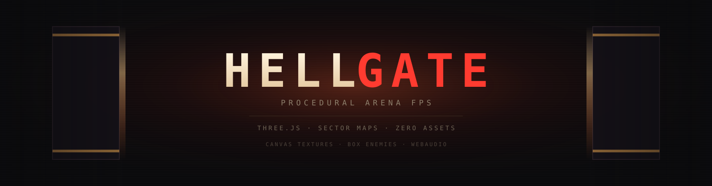

**A Doom-style 2.5D arena shooter that runs in a browser tab.**
Sector maps generated from a seed string · three weapons · two enemy types · **zero external assets**.

[](https://drsamonline.github.io/Hellgate/play/)
[](documentation/architecture.md)
[](ENHANCEMENTS.md)

[](LICENSE)
[](../../actions/workflows/test.yml)
[](https://threejs.org)
[](documentation/architecture.md#no-assets)
[](#no-build-step)

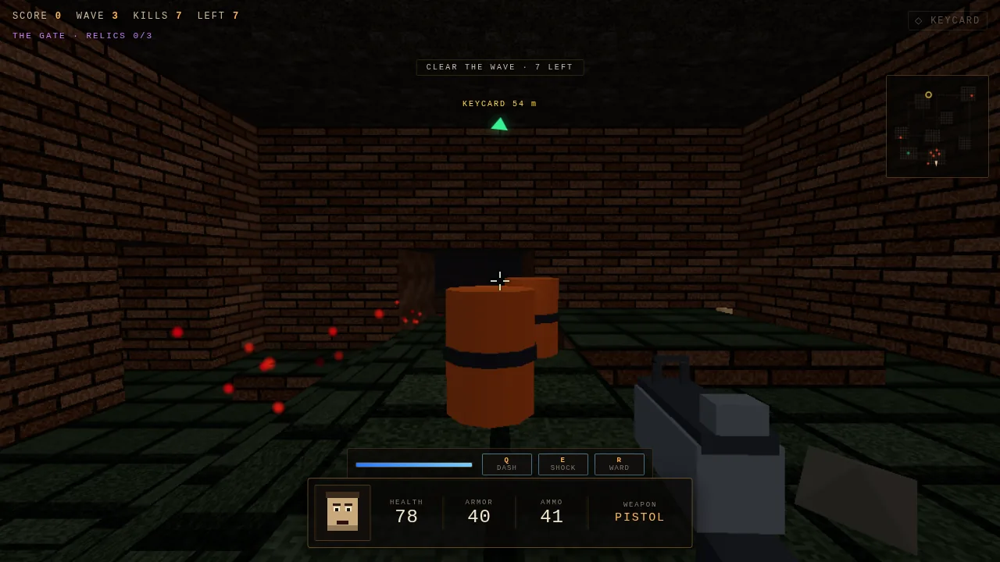

</div>

---

## What this is

A complete little game, and a reference for how far you can get in Three.js without loading a
single image, model or audio file.

Every texture is painted onto a `<canvas>` at boot. Every enemy is a compound of boxes and cones.
Every sound is a WebAudio oscillator or noise burst. The level is a 40×40 grid of sectors generated
from whatever you type into the seed box.

```bash
git clone https://github.com/drsamonline/Hellgate.git
cd hellgate
python3 -m http.server 8000   # any static server
# → http://localhost:8000        landing page
# → http://localhost:8000/play/  the game
```

No `npm install`, no bundler, no build step. Three.js is vendored in `play/vendor/`.

## Play

**[▶ Live demo](https://drsamonline.github.io/Hellgate/play/)** — served straight from this repo by GitHub Pages.

| Input | Action | Input | Action |
| --- | --- | --- | --- |
| `W A S D` | move | `1` `2` `3` | pistol · shotgun · rocket |
| `Shift` | sprint | `Q` `E` | cycle weapons |
| `Space` | jump | `LMB` | fire (hold for auto) |
| Mouse | look (pointer lock, with a fallback) | `Esc` | pause |
| `` ` `` or `F3` | fps · draw calls · triangles | `M` | mute |
| `F` | fullscreen | touch | on-screen sticks and buttons |

Clear a wave and the exit unlocks; walk onto the glowing pad to spawn the next, harder one.
From wave 3 the exit is also keycard-locked.

## Screenshots

Real frames, captured by `tools/shoot.mjs` running the actual game headless in Chromium with
software WebGL, then converted to WebP by `tools/optimise_assets.py` (2.2 MB of PNG becomes 207 KB).
Nothing here is a mockup or a composited image.

| | |
| --- | --- |
| 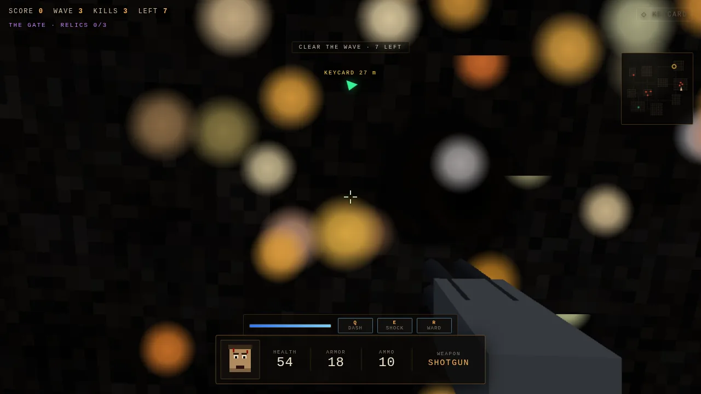 **Shotgun** — 8 pellets, per-pellet damage falloff, blood decals | 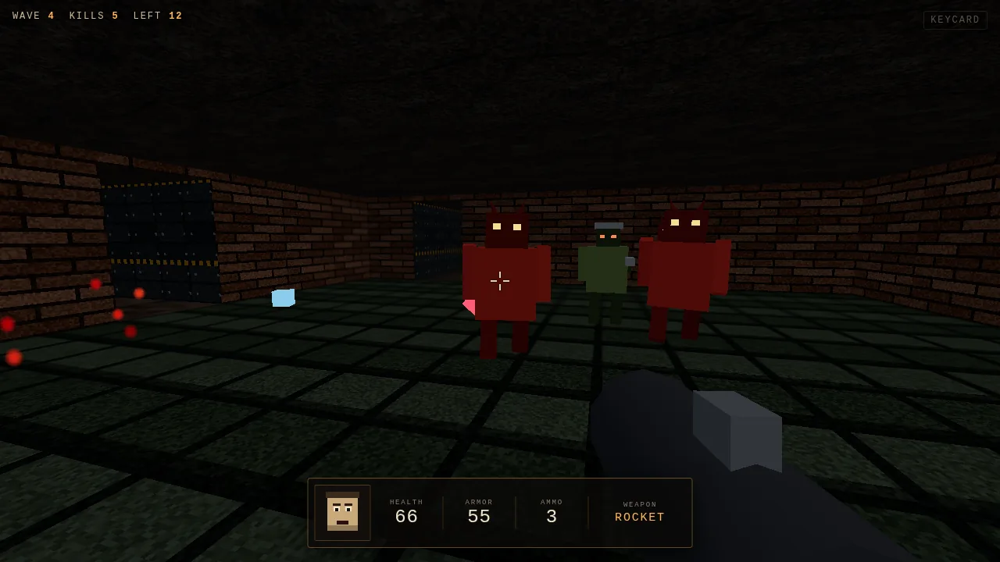 **Rocket** — splash damage, pooled particles, a real point light, screen shake |
| 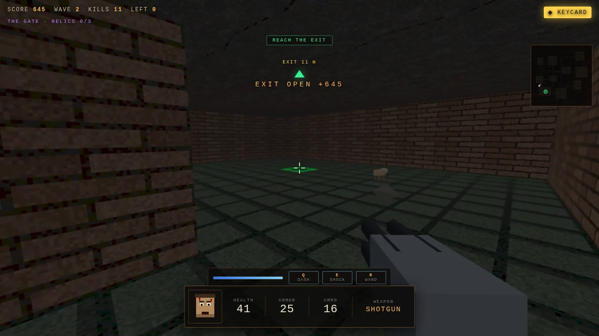 **Exit** — wave cleared, doors open, pad lit | 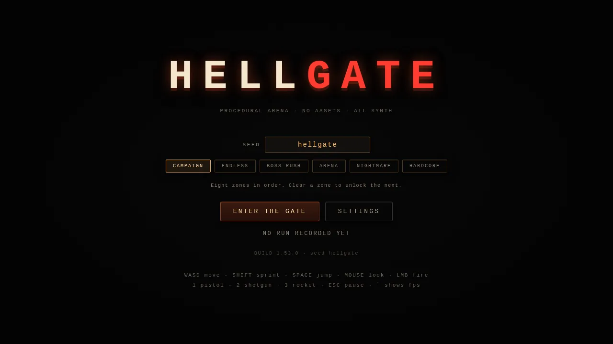 **Title** — seed entry, best run from localStorage |
| 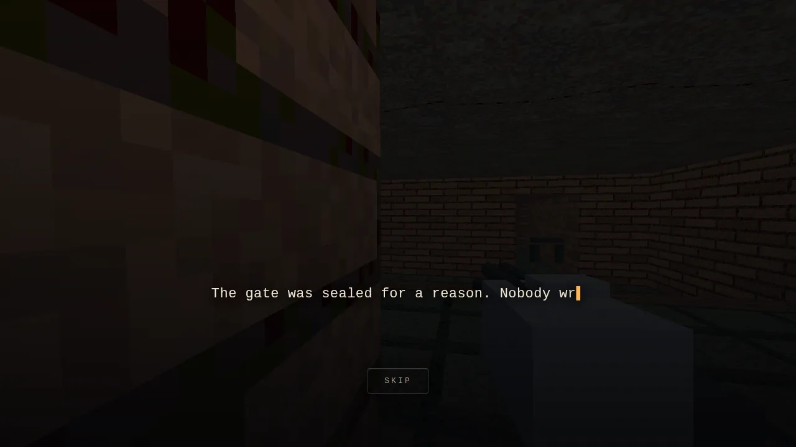 **Cold open** — typed panels over the level you are about to play | 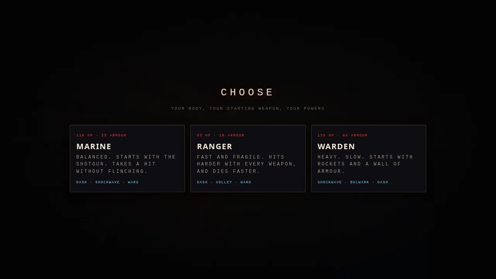 **Class** — body, starting weapon, powers |
| 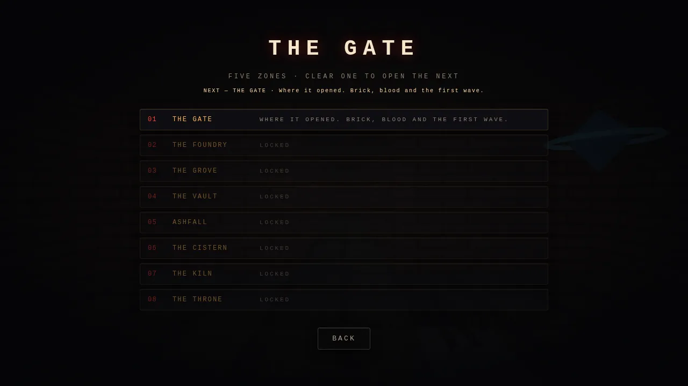 **World map** — five zones, clear one to open the next | 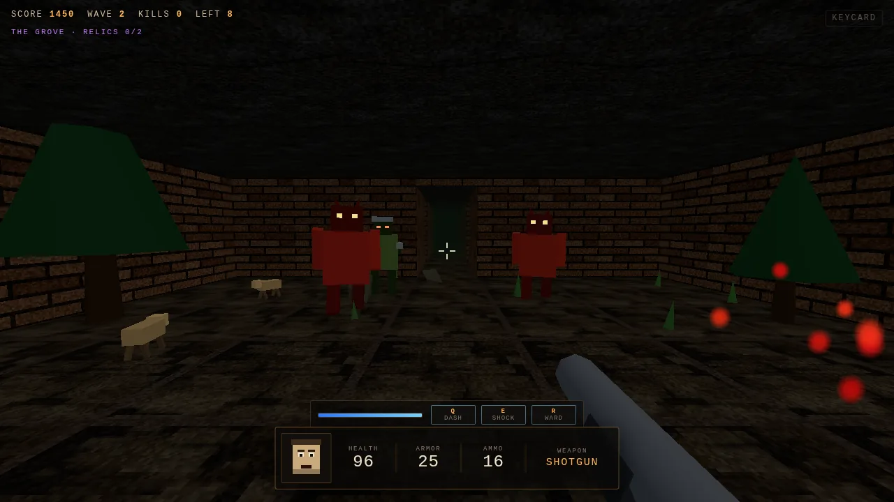 **Grove** — trees, grass, animals, and the energy bar | 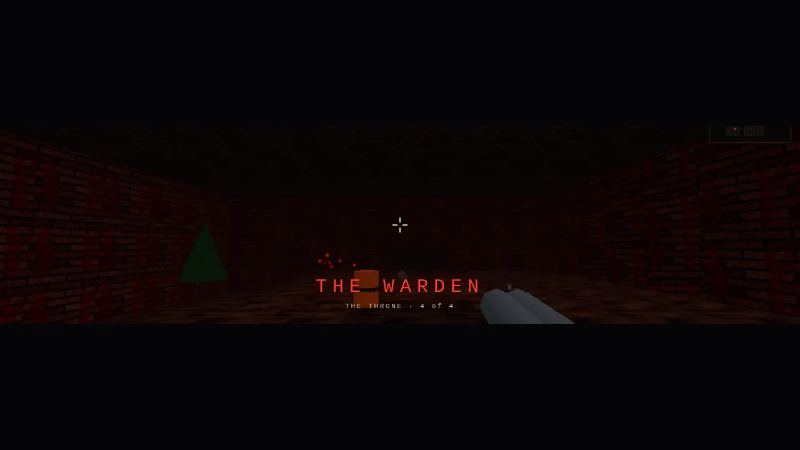 **The warden** — 620 hp, ground slam and a three-ball volley | 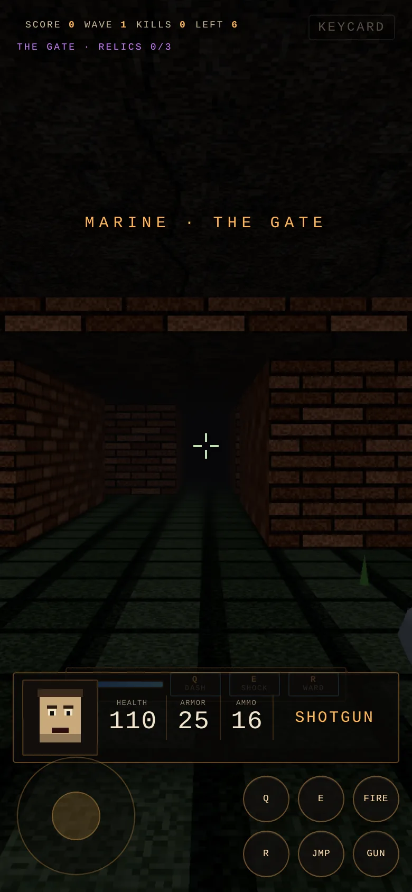 **On a phone** — stick, look, tap to fire, six buttons | 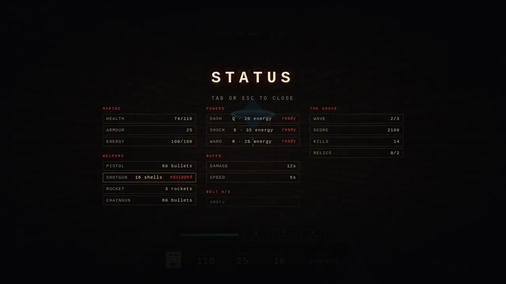 **Status** — `Tab`: class, weapons, powers, buffs, relics |

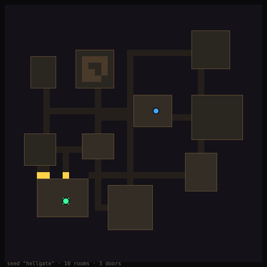

### The map is a seed

Rooms are carved as rectangles, joined by L-shaped corridors, then given random ceiling heights
so corridor mouths read as doorways. The exit room is sealed behind its doors, one room gets a
0.5 m raised ledge, and the whole static level is merged into **five meshes**, five draw calls
for the entire map.

`hellgate` → 10 rooms, 3 doors, 1 exit. Type it again and you get the same map down to the brick.
The picture on the right is rendered from the live generator by `tools/map.mjs`, not drawn by hand.

<br clear="right" />

## Features

**Engine** — sector grid with per-cell floor/ceiling heights · hand-built UVs and normals, no geometry library · merged geometry, five draw calls · **baked sun/shade and corner AO in vertex colours** · filmic tone mapping · adaptive resolution (gives up pixels, not frames) · circle-vs-wall sliding collision with a 0.5 m step limit · frame-rate independent movement (`v *= exp(-k·dt)`) · fog culling · anisotropic filtering.

**Combat** — hitscan pistol · 8-pellet shotgun with falloff · rocket with splash, light and shake · muzzle flash lights · tracers · scorch and blood decals · per-enemy hit flash.

**Enemies** — imps (telegraphed fireballs), grunts (hitscan, melee) and hounds (fast, melee-only, die to one shotgun blast) on one FSM: `IDLE → CHASE → ATTACK → PAIN → DEATH` · **BFS flow-field navigation, one field shared by every enemy** · grid line-of-sight · wandering · gibs · shared geometry per type.

**Audio** — synthesised, spatialised: every enemy sound is panned by direction and attenuated by distance, and no two plays are identical.

**Feel** — Doom-style face that degrades with health · damage direction arrows · red edge vignette · weapon sway and bob · pooled particles, tracers, decals and lights (nothing allocates per shot).

**RPG layer** — three classes with their own body, weapon and powers · five powers on an energy pool (dash, shockwave, ward, volley, bulwark) · a companion drone that follows and fights · five zones with unlock progression, the last one a three-phase boss · an upgrade choice between zones · trinkets that drop from kills · a run saved at every wave and offered as Continue · a status panel on Tab · a relic side objective in every zone · wall terminals to read · timed damage and haste pickups · a story cold open · mobile touch controls.

**Meta** — seeded maps · three difficulty presets · score with a per-wave time bonus · wave difficulty curve · procedural pickups · keycard gate · title / pause / game-over screens · best run in `localStorage`.

## Architecture

```
index.html            landing page (GitHub Pages root)
play/index.html       the game: markup, HUD, screens, CSS, import map
play/src/main.js      boot, input, state machine, wave flow, render loop
play/src/level.js     LEVEL GEN + collision + wall raycast — no Three.js, unit-testable
play/src/levelmesh.js sector grid → five merged BufferGeometries
play/src/textures.js  canvas-painted textures and materials
play/src/player.js    movement, look, step-up, damage, ammo
play/src/weapons.js   view models, hitscan, pellets, rockets
play/src/enemies.js   imp + grunt, FSM, LOS, attacks, gibs
play/src/projectiles.js  rockets and fireballs
play/src/effects.js   tracers, decals, particles, lights, shake
play/src/hud.js       face, counters, crosshair, damage arrows
play/src/audio.js     WebAudio synth — no samples
play/src/classes.js   three classes: body, starting weapon, power set
play/src/powers.js    energy pool, five powers, cooldowns
play/src/world.js     five zones, unlock progression, best score per zone
play/src/story.js     the cold open: typed panels over a camera flythrough
play/src/props.js     instanced trees, rocks and grass; animals that bolt
play/src/companion.js the drone that follows you and shoots
play/src/lore.js      wall terminals you can read with V
play/src/loot.js      trinkets: what a kill can drop, and what they do
play/src/minimap.js   the floor plan, drawn once with live markers
play/src/bloom.js     the post pass: bright pixels blurred and added back
play/src/touch.js     mobile sticks and buttons
play/src/settings.js  sensitivity, FOV, reduced motion, volume, difficulty — persisted
play/src/rng.js       seeded PRNG
tests/                three headless suites
tools/                screenshot, map render, claim check, smoke, lighthouse, asset optimiser
documentation/        architecture, level gen, combat, tuning, testing
```

`level.js` deliberately imports nothing from Three.js. That is what lets the generator be tested in
Node, so reachability, determinism, collision and raycasts are all testable without a browser or a GPU.

## Testing

```bash
bash tests/run.sh
```

| Suite | What it proves |
| --- | --- |
| `test-level.mjs` | 47 seeds: determinism, every room reachable, spawn free, exit pad unreachable while doors are shut, a 400-step random walk never ends inside a wall, raycast sanity |
| `test-geometry.mjs` | every merged triangle's winding matches its normal **and** its normal points into open space, which catches inverted faces that logic tests cannot see |
| `test-playability.mjs` | five zones × six seeds, played: the spawn is free, the exit is reachable, the keycard is on reachable floor, no pickup or enemy is out of reach, no body stands inside rock, and clearing the wave opens the exit |
| `test-game.mjs` | boots, walks, looks, fires all three weapons, kills, takes damage, closes on an enemy along the flow field, clears a wave, opens the exit, advances, checks the keycard gate, dies, restarts, pauses, then 2000 frames of random input without a crash |

Two gates sit on top of the suites:

| Gate | What it proves |
| --- | --- |
| `node tools/check-claims.js` | every number in this README matches the thing that produces it: roadmap count, suite count, module count, lines of code, licence, version, sponsor links |
| `node tools/smoke.mjs` | the real pages load in headless Chromium: import map resolves, images decode, internal links return 200, the game boots, starts a run and honours the URL hooks, with no console errors |

The suites run against a stub of the DOM and of Three.js so they need no browser and no network.
They also pass unmodified against the real library (`three@0.187`, with only `WebGLRenderer` faked) —
which is how the game was checked against the current release and not only against a mock.

## Documentation

- [Getting started](documentation/getting-started.md) — clone to first run in five minutes
- [Architecture](documentation/architecture.md) — modules, data flow, render loop
- [Balance](documentation/balance.md) — the curve, the dials, and what is not measured
- [Level generation](documentation/level-generation.md) — sectors, rooms, corridors, doors, sealing
- [Combat](documentation/combat.md) — weapons, enemy FSM, damage model, projectiles
- [RPG systems](documentation/rpg-systems.md) — classes, powers, companion, zones, story, touch
- [HUD and feel](documentation/hud-and-feel.md) — feedback systems and why they exist
- [Tuning](documentation/tuning.md) — every constant worth changing, and what it does
- [Testing](documentation/testing.md) — how the harness works, how to add a suite
- [API](documentation/api.md) — every exported symbol, one line each
- [Enhancement roadmap](ENHANCEMENTS.md) — 63 ideas, quick wins first

## Performance

Five draw calls for the level, ~2.7k triangles, pooled effects, `devicePixelRatio` capped at 1.5 and
adapting downward under load, fog from 9 to 32 units, frustum culling on enemies. Each enemy is ~12
small meshes, so a packed room of 24 is a few hundred calls, fine on a desktop GPU. Press `` ` `` in
game to see the truth for your machine.

Landing page, measured with `node tools/lighthouse.mjs`:

| | Performance | Accessibility | Best practices | SEO | LCP | CLS | TBT |
| --- | --- | --- | --- | --- | --- | --- | --- |
| Mobile | 75 | 100 | 100 | 100 | 1.2 s | 0 | 1.4 s |
| Desktop | 62 | 100 | 100 | 100 | 1.3 s | 0 | 0.85 s |

These are headless Chromium on a **software rasteriser**, so paint and blocking time read several
times worse than on real hardware. Compare runs against each other, not against a scoreboard. The
game page scores 100 on accessibility and best practices; its performance score is not reported,
because a WebGL scene on SwiftShader measures the rasteriser, not the game.

Three fixes came out of this measurement: the map SVG went from 1,600 `<rect>` elements to 8 paths
(96 KB to 6.4 KB), a full-viewport `mix-blend-mode` grain layer became a body background, and two
text colours moved from 2.56:1 to above 4.5:1.

## Support

| | |
| --- | --- |
| GitHub Sponsors | [github.com/sponsors/drsamonline](https://github.com/sponsors/drsamonline) |
| Ko-fi | [ko-fi.com/matneo](https://ko-fi.com/matneo) |
| PayPal | [paypal.me/drsohilmomin](https://paypal.me/drsohilmomin?locale.x=en_GB&country.x=IN) |
| My books | [Amazon author store](https://www.amazon.com/stores/author/B08ZT331LY/allbooks) |
| More apps | [drsamonline.github.io](https://drsamonline.github.io/) |
| Email | [sohilmomin2000@gmail.com](mailto:sohilmomin2000@gmail.com) |

Nothing is gated behind it: no accounts, no tracking, no network requests. HELLGATE is PolyForm Noncommercial licensed — free to play, study and fork for anything noncommercial; not to sell
and always will be. The support links pay for the hours that go into
[the roadmap](ENHANCEMENTS.md), not for access to anything.

## Security and privacy

No server, no accounts, no telemetry, no third-party requests. See [SECURITY.md](SECURITY.md) for the
reporting process and [PRIVACY.md](PRIVACY.md) for the one `localStorage` key this game writes.

## Contributing

Issues and PRs are welcome, especially new enemy types, better enemy navigation (see
[roadmap #1](ENHANCEMENTS.md)), and seeds that break the generator. Run `bash tests/run.sh` before
you open a PR; the geometry suite catches the mistakes that are invisible in a diff.
See [CONTRIBUTING.md](CONTRIBUTING.md).

## Credits

Built with [Three.js](https://threejs.org). Inspired by id Software's Doom (1993): the sector
model, the face in the HUD, and the idea that a game is more fun than a tech demo.

Four techniques are borrowed from [remorses/castle-valley](https://github.com/remorses/castle-valley),
a painterly Three.js game: light and shade baked once into the geometry instead of computed per
frame, a renderer-level grade in place of a flat output, resolution that adapts to the frame budget,
and audio that is heard from where it stands. Credit to [@remorses](https://github.com/remorses).

## License

[PolyForm Noncommercial 1.0.0](LICENSE) © Dr Sohil Momin
